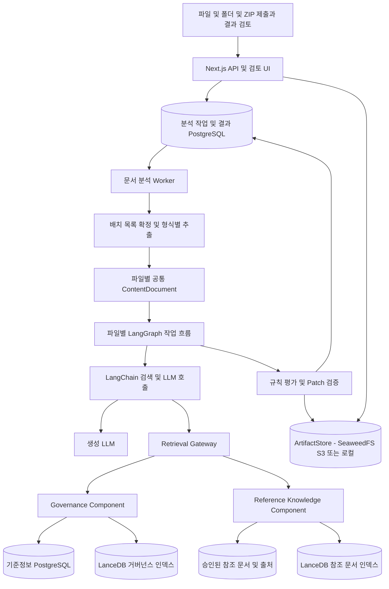
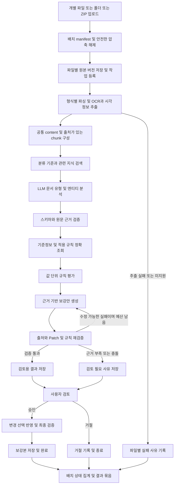

# RAG 기반 문서 의미분석·내용 보강 서비스 아키텍처

작성일: 2026-10-10 · 상태: 구현 전 제안

기존 Governance Knowledge를 독립 컴포넌트로 사용하고, 이미지·PDF·MD·TXT·LOG를 개별 파일·폴더·압축 파일로 받아 파일별 의미를 분석하고 content를 보강하는 서비스다. 회사 기준과 참고 지식을 RAG로 조회하고, 거버넌스 적용과 보강 검증은 별도 단계로 수행한다. 본 문서는 현재 구현과 신규 설계를 구분한다. 실행 단계와 완료 기준은 [작업 계획안](rag-document-enrichment-plan.md)에 정의한다.

## 1. 목표와 결과물

입력 문서에 유형·부서·보안 등급이 명시되어 있다고 가정하지 않는다. LLM이 본문과 거버넌스 정의를 함께 읽고 문서 유형, 용어의 의미, 값이 가리키는 대상을 추출한다. 추출한 속성은 근거를 가진 추정값으로 저장하며, 근거가 없으면 `UNKNOWN`으로 남긴다.

여기서 content 보강은 다음을 포함한다.

| 보강 종류       | 예시                                       | 기본 적용 방식                                   |
| --------------- | ------------------------------------------ | ------------------------------------------------ |
| 의미 메타데이터 | 문서 유형, 요약, 주제, 관련 Term           | 별도 analysis JSON으로 저장                      |
| 표현 표준화     | 문맥상 같은 의미인 별칭을 표준 용어로 변경 | 대상 구간·근거를 가진 patch 제안                 |
| 설명 보강       | 회사 기준에 따른 직급·용어 정의 설명       | 출처가 있는 주석 또는 별도 보강 절               |
| 누락·모순 안내  | 내부 감사 문서에 필요한 항목의 누락        | finding으로 보고; 없는 사실을 생성하지 않음      |
| 규칙 적용       | 주민등록번호 마스킹과 결과 형식 확인       | 코드로 변환·검증한 파생본 생성                   |
| 거버넌스 추천   | 미등록 별칭이나 새로운 개념                | 검토 대상으로 제안; 수락 전 기준정보가 되지 않음 |

파일별 산출물은 추출한 `content.json`, `enriched.content.json`, `analysis.json`, `findings.json`, 변경 diff, 근거 목록, `enriched.md`다. 배치에는 상대 경로와 파일별 처리 결과를 연결한 manifest 및 묶음 다운로드를 제공한다. 원본을 덮어쓰지 않고 원본 버전과 연결한 보강본을 만든다. 본문 사실을 바꾸거나 외부 지식을 덧붙이는 변경은 MVP에서 사용자 검토 후 최종 산출물에 반영한다.

PDF·이미지의 기본 보강 결과는 공통 content 구조와 파생 Markdown이다. 텍스트 마스킹이 원본 PDF·이미지의 픽셀·숨은 텍스트 제거를 의미하지 않는다. 원본 형식의 마스킹 파일 제공은 별도의 렌더링·삭제 검증 기능으로 다루며, 기본 보강본 묶음에 원본 바이너리를 포함하지 않는다.

## 2. 기술 선택

로컬 자원 제약에 따라 기본 모델 실행은 NVIDIA 호스팅 API로 전환한다. 현재 OCR는 `qwen/qwen3.5-122b-a10b`, embedding은 `nvidia/llama-3.2-nv-embedqa-1b-v2`를 사용하도록 adapter와 Compose 설정을 구현했다. 후속 의미분석·보강도 NVIDIA chat API를 사용하며 LangChain 연결은 해당 단계에서 추가한다. 로컬 모델 서버는 선택 프로필로 유지한다. SeaweedFS는 자원이 필요한 시점에 추가하고 현재 로컬 파일 저장소를 유지한다. API 무료 이용은 개발·평가 범위이며 실제 endpoint 한도와 품질은 API 키 연결 후 확인한다.

| 요소                    | 제안                                                           | 이유                                                              |
| ----------------------- | -------------------------------------------------------------- | ----------------------------------------------------------------- |
| 관리·검토 UI / API      | Next.js + TypeScript + shadcn/ui                               | 현재 코드와 운영 흐름 재사용                                      |
| 분석 worker             | 별도 Node.js 프로세스, TypeScript                              | 긴 모델 호출을 HTTP 요청 수명에서 분리                            |
| RAG·모델 연결           | LangChain JS/TS                                                | 검색 포트, 모델 adapter, 구조화 출력 조합                         |
| 작업 흐름               | PoC는 순차 실행, 검토·복구 포함 MVP는 LangGraph                | 조건 분기·검토 대기·재개가 필요한 시점에 도입                     |
| 원본·기준정보·작업·결과 | PostgreSQL                                                     | 트랜잭션, 버전, 근거 추적                                         |
| 의미 검색               | LanceDB                                                        | 기존 검색 adapter 활용, 참조 문서 인덱스 추가                     |
| 파일 저장               | 로컬 PoC는 영속 볼륨, 서비스 MVP는 SeaweedFS S3 adapter 기본안 | 원본·추출 이미지·보강본을 API와 worker가 공유                     |
| Markdown 구조           | remark/mdast 계열 AST parser                                   | 문단·표·코드와 위치를 보존                                        |
| 멀티모달 추출           | 형식별 parser, PDF 추출, OCR, vision 모델 adapter              | 시각 정보와 근거 위치를 공통 content로 변환                       |
| 모델                    | 생성 LLM과 EmbeddingProvider를 별도 구성                       | Qwen3-Embedding-4B는 검색용; 의미분석·문장 생성용 LLM은 별도 필요 |

LangChain은 검색·모델 호출을 구성하는 라이브러리다. 기존 SQL/API를 검색 소스로 연결할 수 있으며 모든 지식을 새 Vector Store에 복제할 필요는 없다. 검색 후 생성하는 고정 흐름을 먼저 구현한다. [공식 Retrieval 문서](https://docs.langchain.com/oss/javascript/deepagents/retrieval)

LangGraph의 graph는 실행 단계 사이의 연결이다. Graph DB를 도입한다는 뜻이 아니다. 이 설계에서는 검토 보류·재개와 제한된 재처리 경로를 포함하는 MVP부터 사용한다. [공식 LangGraph 개요](https://docs.langchain.com/oss/javascript/langgraph/overview)

## 3. 컴포넌트 구성



초기에는 같은 저장소·같은 PostgreSQL 인스턴스를 사용해도 된다. 컴포넌트별 데이터 소유권과 포트를 나누고 app, index-worker, analysis-worker를 별도 프로세스로 실행한다. 거버넌스 컴포넌트 분리 배포 시에는 포트 구현을 HTTP client로 교체한다.

| 컴포넌트                | 소유 데이터와 책임                                 | 다른 컴포넌트에 제공할 것                                  |
| ----------------------- | -------------------------------------------------- | ---------------------------------------------------------- |
| Governance              | Term, Expression, Rule, 직급 체계, 문서 유형 정의  | 정의 검색, 정확한 코드 조회, 적용 규칙, 버전 고정 snapshot |
| Reference Knowledge     | 승인된 사내 매뉴얼·정책 원문·용어 해설             | 권한·유효기간·출처를 가진 검색 결과                        |
| Document Enrichment     | 대상 문서, 분석 실행, 의미 추출, 보강안, 검토 결과 | 분석 API와 근거가 있는 파생 산출물                         |
| Ingestion / Extraction  | 업로드 배치, 상대 경로, 압축 목록, 형식별 추출     | 파일별 원본 버전, 공통 content, 추출 품질·오류             |
| Rule Evaluation         | 의미가 확인된 값·문서 속성에 대한 조건 평가        | PASS / VIOLATION / UNKNOWN / NOT_APPLICABLE 및 근거        |
| 사용자 속성·권한 시스템 | 직원 소속·현재 직급·조회 권한                      | 필요 시 외부 연동; 이번 content 보강 MVP에서는 구현 제외   |

회사 직급의 비교 순서와 DocumentType 정의는 Governance가 관리한다. 직급 체계가 복수이면 `gradeSchemeId` 안에서만 순서를 비교한다. 직책과 직급을 혼용하거나 서로 다른 체계를 숫자로 직접 비교하지 않는다.

문서에서 “인사팀 과장 이상이 조회 가능”이라는 제한을 도출하는 것과 특정 사용자의 조회 허용을 결정하는 것은 별도 결과다. 이번 서비스는 전자를 규칙 참조와 함께 보강 정보로 제공한다. 사용자 속성 없이 실제 ALLOW를 반환하지 않는다.

## 4. 현재 코드와 연결 지점

2026-10-10 코드 확인 기준이며 과거 README의 범위 설명보다 아래 코드 상태를 기준으로 한다.

| 현재 구현                                               | 재사용 / 필요한 변경                                                                                                           |
| ------------------------------------------------------- | ------------------------------------------------------------------------------------------------------------------------------ |
| `src/domain/ports.ts`의 EmbeddingProvider / VectorStore | 검색 인터페이스 재사용. VectorStore의 Term·Expression·Rule 전용 레코드는 참조 문서 chunk에 그대로 사용하지 않고 별도 계약 추가 |
| `src/application/search.ts`                             | 후보를 PostgreSQL에서 다시 확인하는 방식 재사용. LLM 컨텍스트에는 요약 응답 외에 정의·Rule 전체·version이 필요                 |
| `src/application/transform.ts`                          | 파일 검증과 변환 서비스 경계 재사용. 현재 활성 규칙 전체를 분류하므로 신규 의미분석 경로용 적용 범위 resolver 추가             |
| `src/domain/transform.ts`                               | 치환 형식·완료 패턴 검증 로직 재사용. 현재 전체 본문 패턴 실행을 엔티티에 연결된 값 구간 실행으로 확장                         |
| `ActiveGovernancePort.loadActive()`                     | 현재 Rule DTO에 `termId`, `scope`, `version`, `priority`가 없으므로 snapshot 계약에서 보강                                     |
| PostgreSQL index_jobs + worker                          | 검색 인덱스 동기화 전용으로 유지. 문서 분석 작업은 별도 테이블·worker가 소유                                                   |
| `/api/transform`                                        | 현재 1MB 이하 UTF-8 MD를 메모리에서 처리하고 원문 미저장. 신규 비동기 분석 API와 구분                                          |
| `docs/semantic-matching-roadmap.md`                     | AST·값-엔티티 연결·평가셋·추천 작업을 이 계획의 단계에 통합                                                                    |

현재 package.json에는 LangChain/LangGraph가 설치되어 있지 않다. 이 문서는 신규 서비스의 계획이며 해당 기능이 이미 구현됐다는 의미가 아니다.

## 5. RAG 지식 구성과 검색

RAG의 참조 지식과 신규 분석 대상 문서는 역할이 다르다.

1. **거버넌스 지식**: 등록된 용어·별칭·규칙, 직급 기준, 문서 유형 정의와 분류 예시.
2. **참조 문서**: 관리자가 승인한 정책 원문·업무 매뉴얼. 소유자·버전·유효기간·읽기 범위를 등록한다.
3. **대상 문서**: 이번 분석의 입력. 기본적으로 지식베이스에 자동 편입하지 않는다. 생성 보강본도 승인 없이 다시 RAG 근거가 되지 않는다.

참조 지식 적재 흐름:

```text
참조 문서 등록·승인 → 형식별 추출 및 공통 content 구성 → 출처·버전이 있는 chunk 저장
→ 영속 인덱싱 작업 → embedding → LanceDB upsert
```

정확 일치 검색과 의미 검색을 조합한다. 코드·문서 유형 정의·등록 별칭은 SQL/정확 검색으로 조회하고, 문맥상 관련된 해설과 유사 개념은 LanceDB로 검색한다. 긴 문서는 문서 전체 벡터 하나에 의존하지 않고 제목·절·표의 문맥을 유지한 chunk별 검색 후 중복 근거를 합친다. 후보 수와 reranking 도입 여부는 평가셋으로 조정한다.

검색 결과에는 최소 `sourceId`, `sourceVersion`, `chunkId`, 원문 위치, 본문, 적용 범위, 유효기간이 필요하다. 후보 ID를 받은 뒤 원본 상태·권한·버전을 재확인하고, 모델에 보내기 **전에** 허용된 근거만 남긴다. 거버넌스가 명시한 규칙과 참고 문서의 설명이 충돌하면 자동으로 한쪽을 택하지 않고 충돌을 보고한다.

필수 규칙 적용 여부를 Vector topK에 맡기지 않는다. 의미분석 후 확인된 Term·DocumentType·범위에 대해 연결된 전체 활성 규칙과 전역 필수 규칙을 정확 조회한다. 문서 유형이 UNKNOWN이면 관련 규칙을 불필요하다고 간주하지 않고 적용 여부 미확정으로 기록한다. 인덱스 장애·지연으로 근거가 누락된 경우에도 “규칙 없음”과 구분한다.

LanceDB는 governance와 reference 용도별 테이블·프로필을 구분한다. 기존 mock과 실제 embedding 벡터를 섞지 않는다. MVP에서는 두 종류 인덱스의 쓰기를 하나의 index-worker가 소유하고 analysis-worker는 읽기만 수행한다. 프로필·모델·차원·텍스트 구성 변경 시 재인덱싱한다.

## 6. 의미분석과 보강 흐름

전체 흐름은 **배치 업로드 → 파일 목록 확정 → 파일별 추출 → RAG 의미분석 → 거버넌스 적용 → content 보강 → 검증·검토 → 파일별 결과 및 배치 결과**다. 입력 폴더를 하나의 거대한 모델 컨텍스트로 합치지 않는다.



### 업로드와 파일별 추출

| 입력          | 전처리 및 의미분석 입력                                                  | 보존할 위치                               |
| ------------- | ------------------------------------------------------------------------ | ----------------------------------------- |
| MD / Markdown | AST로 제목·문단·표·코드·링크 구성                                        | block ID, 행·문자 범위                    |
| TXT           | 인코딩 검증 후 문단 구성, UTF-8 기본                                     | 행·문자 범위와 원본 바이트 매핑           |
| LOG           | 행·이벤트 묶음, 알려진 형식의 timestamp·필드 추출                        | 원문 행, 원래 시간 표현; 시간대 미상 유지 |
| PDF           | 페이지별 텍스트·표·이미지 추출, 스캔 영역 OCR, 필요한 페이지 vision 분석 | 페이지, 영역 좌표, 원본 텍스트와 OCR 구분 |
| 이미지        | PNG/JPEG/WebP 우선; OCR와 vision으로 표·도표·배치·시각 의미 분석         | 이미지 ID, 크기, 근거 영역 좌표           |

OCR는 문자를 읽는 단계이고 의미분석은 추출 내용·시각 자료를 회사 기준과 연결하는 단계다. 그림·도표의 의미를 OCR만으로 대체하지 않는다. 읽기 어려운 영역, 지원하지 않는 인코딩·로그 형식은 오류 또는 UNKNOWN으로 남기며 추측한 내용을 원문으로 저장하지 않는다.

폴더 업로드는 하위 파일과 상대 경로 목록을 전달한다. 압축은 첫 버전에서 ZIP을 지원하며, 암호화 ZIP·중첩 압축·다른 압축 형식은 미지원 항목으로 명시한다. 서버는 실제 형식을 검증하고 절대 경로·상위 경로 이동·심볼릭 링크·중복 경로를 차단한다. 해제 후 총 용량·파일 수·깊이·확장 비율, PDF 페이지 수·이미지 픽셀 수에 한도를 둔다. 목록 확정이 중단되면 `enumerationComplete=false`로 기록하고 전체 성공으로 표시하지 않는다. 한도 값은 평가 후 배포 설정으로 고정한다.

각 파일의 `ContentDocument`는 불변 원본 버전, 추출 버전, 형식, block 목록, 텍스트·표·이미지 참조, 원문 위치, 추출 엔진·버전 및 품질 정보를 가진다. 원본 바이트와 추출 결과를 구분하고 보강 patch는 `contentVersionId`를 대상으로 한다. 이미지 설명은 모델 추론으로 표시하며 직접 추출한 원문과 구분한다.

기본 RAG는 추출 텍스트·이미지 설명으로 텍스트 embedding을 사용한다. 필요한 원본 페이지·이미지는 허용된 범위에서 vision 모델에 전달한다. 이미지 자체의 벡터 검색은 평가 후 추가할 선택 기능이다. 같은 폴더라는 이유로 다른 파일 내용을 사실 근거로 합치지 않는다. 파일 간 참조를 허용할 경우 별도의 범위 설정과 원본 근거를 남긴다.

### 분석

- 공통 content에서 문단·표 헤더·셀·시각 영역·로그 이벤트와 원문 위치를 유지한다. Markdown은 AST 구조도 보존한다.
- 문서 유형은 회사의 분류 정의를 기준으로 선택한다. 분류가 복합적이면 복수 후보와 각각의 근거를 반환한다.
- 용어를 문맥에 연결한다. 동일한 숫자 패턴이라도 어떤 열·라벨·문장에서 나온 값인지 구별한다.
- 모델이 만든 offset을 그대로 쓰지 않는다. 제공한 block ID와 인용문을 원문에서 검증해 위치를 확정한다.
- schema 준수와 사실 정확성은 별개다. 모델의 자기보고 confidence를 정답 확률로 취급하지 않는다. 자동 적용 기준은 별도 정답셋에서 측정·보정한다.

LangChain의 모델 구조화 출력 기능을 쓰고 Zod로 파싱한다. 사용 모델의 JSON schema 지원 범위를 확인하며, 형식 오류를 빈 정상 결과로 대체하지 않는다. [공식 Models 문서](https://docs.langchain.com/oss/javascript/langchain/models)

### 보강 및 규칙 적용

기본 LLM 작업은 “의미분석”과 “보강안 생성” 두 단계다. 짧은 문서에서는 분석 1회 + 필요한 경우 보강 1회를 기준으로 시작한다. 긴 문서는 chunk 분석과 병합 때문에 호출 수가 증가하므로 하나의 작업을 단일 API 호출로 보장하지 않는다.

LLM은 구간별 변경 제안과 근거를 반환한다. deterministic 규칙 엔진이 마스킹·형식·완료 패턴을 평가하고 patch를 적용한다. 본문 전체를 모델이 다시 써서 링크·코드·표 구조가 바뀌는 방식은 기본 경로로 사용하지 않는다.

각 patch는 `documentVersionId`, `contentVersionId`, `blockId`, `beforeHash`, 변경 종류, 새 텍스트, 근거 ID를 가진다. 겹치는 변경, 존재하지 않는 근거, 보호 구간 침범, 원문·추출 버전 불일치를 검증한다. 변환 후 공통 content와 파생 Markdown을 검증하고 잔여 위반·마스킹 완료를 확인한다. 규칙 실패가 있으면 “검증 완료” 보강본으로 확정하지 않는다.

예를 들어 “이 문서는 인사팀 과장 이상만 조회 가능”은 실제 접근 정책을 인용한 설명으로 덧붙일 수 있다. 그러나 본문에 없는 사용자 소속이나 직급을 새 사실로 생성하지 않는다.

### 원문·모델 전송 정책

비동기 처리와 검토 재개에는 원문 버전의 재조회가 필요하므로 신규 서비스는 원문 저장을 전제로 설계한다. 현재 메모리 전용 `/api/transform`과 달라지는 제품 정책이다. 원문 미저장이 필수인 배포에서는 암호화된 임시 저장과 TTL 또는 외부 원문 저장소의 불변 버전 참조를 사용하도록 구현 전에 확정한다.

LLM과 embedding 모델 각각에 전송 가능한 데이터 범위를 설정한다. 민감 값은 필요 시 로컬에서 자리표시자로 바꾸고 위치 매핑은 서버에 보관한다. 외부 모델에는 승인된 전송 범위의 문서만 보낸다. 원문·검색 문서는 분석 데이터로 취급하고 모델이 임의 도구 실행이나 정책 변경을 수행하게 하지 않는다. 로그·추적 시스템에도 같은 보관 기준을 적용한다.

## 7. LangGraph 사용 범위

PoC는 동일한 단계 함수들을 순차 호출해 검색·모델 품질부터 확인한다. MVP에서는 분석 중단 복구, 검토 대기, 제한된 재검색·재작성 요구를 LangGraph 상태 흐름으로 연결한다.

배치 조정자는 파일 목록을 확정하고 파일별 run을 제한된 동시성으로 실행한다. 파일별 추출·분석·검토 상태를 집계하며, 일부 실패가 다른 파일의 성공을 취소하지 않는다. 실패 파일만 재시도할 수 있고 검토도 파일별로 진행한다. 목록 확정 여부와 성공·실패·미지원·검토 대기 개수를 함께 표시하여 부분 결과를 전체 완료로 오인하지 않도록 한다. 파일·페이지·배치별 자원 예산을 함께 제한한다.

```text
thread_id = analysisRunId
상태 = 원본 버전, 처리 단계, chunk 참조, 검색 근거 참조,
       추출 결과, 적용 규칙 snapshot, 변경안 참조, 검증 오류,
       검토 결과, 잔여 호출·토큰·시간 예산
```

- PostgreSQL 기반 checkpointer를 사용한다. 큰 원문과 비밀값을 checkpoint에 반복 복사하지 않고 참조를 저장한다.
- 사용자 검토가 필요하면 `interrupt`로 중단하고 요청·worker 자원을 반환한다. 검토 API가 검토자 권한과 결과 버전을 확인한 뒤 같은 thread를 재개한다.
- 재개 시 node의 일부 코드가 다시 실행될 수 있으므로 결과 저장·patch 적용에 idempotency key를 사용한다. checkpointer만으로 외부 작업의 exactly-once 실행이 보장된다고 가정하지 않는다.
- 작업 큐는 실행할 run을 선택하고 lease·heartbeat·동시 실행을 관리한다. LangGraph는 run 내부의 단계 상태를 관리한다. API용 job 상태는 그래프 상태의 요약이며 별도 진행 상태 머신을 중복 구현하지 않는다.
- 필수 정보 부족은 `WAITING_REVIEW`, 기술 장애는 `FAILED`로 구분한다. 출처 없이 완료 결과를 만들지 않는다.

checkpoint와 thread를 통한 복구, `interrupt`/`Command` 재개는 공식 기능이다. [Persistence](https://docs.langchain.com/oss/javascript/langgraph/persistence), [Interrupts](https://docs.langchain.com/oss/javascript/langgraph/interrupts)

초기 실행 제한 제안: chunk 동시 처리 2개, 검색 보완 최대 1회, 보강안 수정 최대 1회. 기술적 재시도는 별도 최대 2회이며 전체 run의 토큰·시간 한도 안에서만 실행한다. 실제 한도는 선택 모델과 평가 문서 길이로 확정한다.

### 토큰 한도와 불완전 응답 처리

이 절은 구현할 실행 계약이다. LangChain이나 LangGraph 도입만으로 컨텍스트 초과·출력 잘림·분석 누락이 자동 해결된다고 가정하지 않는다. 모델은 작은 작업 단위의 결과를 제안하며, 다음 작업과 전체 완료 여부는 서버가 결정한다.

**호출 전 예산 계산**

- 모델·배포별 `contextWindow`, `maxInputTokens`, `maxOutputTokens`, tokenizer, 이미지 토큰 산정 방식, reasoning 토큰의 한도 포함 방식을 프로필로 관리한다. 모델명만으로 고정 한도를 추정하지 않는다. embedding 모델의 입력 한도는 별도 프로필로 관리한다.
- 입력은 시스템 지침, 출력 schema, 문서 chunk, 검색 근거, 필요한 이전 단계 요약, 이미지 입력을 모두 포함해 계산한다. 모델 tokenizer 또는 provider의 계산 기능을 우선하고, 정확한 계산이 불가능하면 보수적으로 추정한 뒤 여유분을 확보한다. 한글·로그·이미지를 문자 수만으로 동일하게 계산하지 않는다.
- 공유 컨텍스트 한도를 사용하는 모델은 `입력 추정 토큰 + 출력 예약 토큰 + 안전 여유 ≤ contextWindow`를 만족해야 한다. 별도 입력·출력 한도도 각각 검사하며 reasoning 예산은 provider 계약에 따라 중복 계산 없이 예약한다. 출력 예약량은 단계별 schema와 예상 항목 수로 정하고 프로필 최대값을 넘기지 않는다.
- 초과하면 중복·낮은 관련도의 검색 근거를 먼저 줄이고, 문서를 더 작은 작업 단위로 나눈 뒤 다시 계산한다. 필수 규칙·출처·보호 지침을 조용히 삭제하거나 원문을 잘라서 정상 처리하지 않는다. 필수 규칙이 많으면 적용 범위별로 나눠 모두 평가하고 결과를 합친다.

**긴 문서의 분할과 병합**

문단·절·페이지·표 행·로그 이벤트 경계를 이용해 분할한다. 표는 헤더를 반복하고 관련 앞뒤 문맥과 원문 위치를 붙인다. 단일 block도 한도를 넘으면 하위 구간으로 나누며, 분할 불가능한 시각 자료는 페이지·영역별 처리 또는 명시적 검토 대상으로 전환한다. OCR·vision 호출에도 같은 예산 검사를 적용한다.

문서마다 예상 chunk 목록과 처리 coverage를 저장한다. 겹치는 구간의 추출값·patch는 원문 위치로 중복 제거한다. chunk 결과가 많으면 제한된 크기의 묶음으로 계층 병합하며, 병합 호출도 동일하게 예산을 검사한다. 요약은 원문 근거를 대체하지 않는다. 문서 전체에 걸친 필수 항목·모순·분류 검사는 구조화 결과를 집계하고 필요 시 원문 구간을 재조회한다. 전체 문맥을 확인하지 못한 판정은 UNKNOWN으로 남긴다.

**응답 확인과 복구**

| 상황                                    | 실행 동작                                                                                                                    |
| --------------------------------------- | ---------------------------------------------------------------------------------------------------------------------------- |
| 입력 컨텍스트 초과                      | 같은 요청 반복 금지. 근거 축소·chunk 재분할 후 새 하위 작업으로 실행                                                         |
| 출력 한도 도달·응답 잘림                | provider 종료 사유를 adapter에서 정규화하고 미완료로 처리. 출력 여유가 있으면 한도 조정, 없으면 대상·출력 항목을 나눠 재실행 |
| 정상 종료지만 JSON·근거·coverage 불완전 | 성공 처리 금지. 제한된 수정 또는 누락된 작업만 재실행                                                                        |
| stream 단절·timeout·일시 장애           | 부분 출력은 미확정으로 보관. backoff와 jitter로 제한 재시도하고 검증된 단위부터 재개                                         |
| 요청·토큰 rate limit                    | provider 대기 지침을 반영하고 계정·모델별 동시성 및 토큰 처리량을 낮춤                                                       |
| 거절·지원하지 않는 입력                 | 기술적 재시도와 구분해 검토 또는 명시적 실패로 기록                                                                          |
| 재시도·분할 깊이·시간·토큰 예산 소진    | `BUDGET_EXHAUSTED` 사유로 중단 결과 저장. 남은 작업과 재개 조건을 표시하고 자동 무한 재시도 금지                             |

잘린 JSON을 임의로 닫거나 “계속해” 응답을 문자열로 이어 붙여 확정하지 않는다. 각 작은 작업은 요청한 block ID 목록과 각 block의 결과 또는 처리 불가 사유를 반환해야 한다. 서버는 종료 사유, schema, 요청 대상 coverage, 근거와 규칙 검증을 모두 확인한다. 이 검사는 의미 정확성을 보장하는 검사가 아니므로 별도 평가셋도 유지한다.

**영속 작업 단위와 완료 조건**

`runId + stage + chunkId + inputHash + configHash`로 작업 단위를 식별하고 상태·시도·검증 결과·산출물 참조를 저장한다. 재분할 시 부모와 자식 관계를 기록하고 모든 자식이 처리되어야 부모 coverage가 충족된다. 검증된 chunk 결과는 즉시 저장하며, worker 종료 시 이미 확정한 결과를 재사용하고 미확정 단위만 재실행한다. 외부 모델 호출 자체는 중복 발생할 수 있으므로 비용 기록과 결과 중복 반영 방지를 별도로 처리한다.

동시 작업은 호출 전 토큰·비용 예산을 원자적으로 예약하고 실제 usage로 정산한다. usage를 받지 못한 호출은 예약분을 보수적으로 유지한다. chunk·파일·배치 전체에 재시도·재분할·재개 비용을 누적하며 재시도로 예산을 초기화하지 않는다. 사용자가 한도를 변경해 재개할 때도 변경 이력과 기존 사용량을 보존한다.

전체 완료는 서버가 `목록 확정 + 모든 필수 chunk 처리 + 문서 수준 검사 + 보강 검증 + 필요한 검토 완료`로 판정한다. LLM의 “완료했습니다” 문장은 완료 신호가 아니다. UI에는 완료 chunk/전체 chunk, 처리 페이지, 현재 단계, 중단 사유, 누적 사용량 및 재개 가능 여부를 표시한다. 부분 산출물은 다운로드할 수 있어도 최종 검증 완료 결과와 구분한다.

## 8. 데이터와 API 계약

### 데이터 소유권

| 저장 영역           | 주요 엔티티                                            | 필수 속성                                                                   |
| ------------------- | ------------------------------------------------------ | --------------------------------------------------------------------------- |
| Governance          | 기존 Term / Expression / Rule                          | ID, version, 적용 범위, 상태, 우선순위                                      |
| Governance 확장     | JobGrade / DocumentType                                | 안정된 code, 정의, 비교 체계 또는 분류 예시, version, 상태                  |
| Reference Knowledge | KnowledgeSource / SourceVersion / KnowledgeChunk       | 출처, 불변 버전, 승인 상태, 읽기 범위, 유효기간, 위치                       |
| Enrichment          | Document / DocumentVersion                             | 원문 hash, 저장 위치, 소유 범위, 보관 정책                                  |
| Ingestion           | UploadBatch / UploadItem                               | 입력 방식, 상대 경로, 원본 hash, enumerationComplete, 파일별 상태·오류      |
| Extraction          | ContentDocument / ExtractionArtifact                   | 원본·content 버전, block·위치, 엔진 버전, OCR·추론 구분, 추출 품질          |
| Enrichment          | AnalysisRun                                            | 원문 버전, 설정 hash, 모델·프롬프트·검색 프로필·파이프라인 버전, 상태, 비용 |
| Enrichment          | AnalysisArtifact / EnrichmentProposal / ReviewDecision | 추출값, 근거, patch, 결과 파일 참조, 검증 결과, 검토자·시각                 |
| Workflow            | analysis_jobs / checkpoints                            | run ID, lease, heartbeat, 실행 횟수, 저장된 그래프 상태                     |

현재 거버넌스는 전체 변경 이력을 보관하지 않으므로 `ruleId + version`만 기록해서는 과거 판정을 재현할 수 없다. 사용한 Rule·분류 정의의 실제 내용을 run snapshot으로 보관한다. 검색 근거도 source version과 인용 범위를 불변 참조 또는 허용된 snapshot으로 보관한다.

검토 승인 전 원본·규칙·출처의 변경 또는 폐기를 확인한다. 오래된 결과를 그대로 확정하지 않고 재분석 대상으로 전환한다. 이때 기존 run을 덮어쓰지 않고 새로운 run과 이전 run의 관계를 남긴다.

### 신규 API 제안

| API                                          | 동작                                                     |
| -------------------------------------------- | -------------------------------------------------------- |
| `POST /api/upload-batches`                   | 개별 파일·폴더·ZIP의 업로드 세션과 batchId 생성          |
| `POST /api/upload-batches/:id/items`         | 파일 및 상대 경로 등록, 실제 저장 키는 서버 ID 사용      |
| `POST /api/upload-batches/:id/finalize`      | 업로드 완료 확인, 압축 목록 확정·추출 작업 등록          |
| `POST /api/upload-batches/:id/analysis-runs` | 추출된 파일별 분석 run 등록, 미추출 파일은 준비 후 실행  |
| `GET /api/upload-batches/:id`                | manifest와 파일별 처리·검토 상태, 부분 실패 조회         |
| `GET /api/upload-batches/:id/artifacts`      | 권한 검사 후 결과 manifest와 보강본 묶음 제공            |
| `POST /api/documents`                        | 단일 지원 파일 업로드, 내부적으로 파일 1개의 배치 생성   |
| `POST /api/documents/:id/versions`           | 수정 원본을 새 불변 version으로 등록                     |
| `POST /api/analysis-runs`                    | documentVersionId와 보강 옵션으로 작업 등록, 202 + runId |
| `GET /api/analysis-runs/:id`                 | 상태·분석 결과·변경안·검토 사유 조회                     |
| `POST /api/analysis-runs/:id/reviews`        | 변경별 수락·거절 및 필요한 분류 확인, 조건 충족 시 재개  |
| `POST /api/analysis-runs/:id/retries`        | 허용된 기술 장애의 재시도 요청                           |
| `GET /api/analysis-runs/:id/artifacts/:kind` | 권한 검사 후 JSON / 보강 MD / diff 제공                  |

내부 포트는 `BatchIngestor`, `ContentExtractor`, `GovernanceCatalog`, `ReferenceRetriever`, `SemanticAnalyzer`, `RuleEvaluator`, `EnrichmentGenerator`, `ArtifactStore`, `WorkflowRunner`로 구분한다. 외부 호출로 구현할지는 배포 구조에 따라 결정하며 포트만을 위해 모든 기능을 별도 서버로 만들지 않는다.

재요청 중복 방지는 명시적 idempotency key와 원문 version·설정 hash를 함께 확인한다. 원문이 같아도 모델·프롬프트·규칙 버전이 바뀌면 새 분석을 요청할 수 있어야 한다.

배치 내 파일 식별은 상대 경로와 item ID로 구분한다. 이름이 같은 다른 폴더의 파일을 덮어쓰거나, 내용 hash가 같다는 이유로 파일별 결과를 합치지 않는다. 물리 저장 중복 제거와 파일별 분석 이력은 별개다.

### 산출물 예시

아래는 실제 분석 결과가 아닌 응답 계약 예시다.

```json
{
  "runId": "run-001",
  "documentVersionId": "doc-v1",
  "status": "WAITING_REVIEW",
  "analysis": {
    "documentType": {
      "code": "INTERNAL_AUDIT_REPORT",
      "resolution": "INFERRED",
      "evidenceIds": ["input:block-4"]
    },
    "entities": [
      {
        "blockId": "table-2:cell-3",
        "termId": "term-resident-id",
        "resolution": "INFERRED"
      }
    ]
  },
  "enrichments": [
    {
      "kind": "ADD_NOTE",
      "targetBlockId": "block-4",
      "text": "내부 감사 리포트에는 별도의 조회 제한 정책이 적용됩니다.",
      "evidenceIds": ["policy-hr-audit:v3"],
      "reviewRequired": true
    }
  ],
  "findings": [
    {
      "ruleId": "mask-resident-id",
      "ruleVersion": 2,
      "result": "VIOLATION",
      "targetBlockId": "table-2:cell-3"
    }
  ],
  "unresolved": [],
  "artifacts": { "analysis": "artifact-a", "proposal": "artifact-b" }
}
```

## 9. 초기 배포와 확장 조건

### 파일 저장소 선택

폴더·ZIP·PDF·이미지 입력은 원본 외에도 페이지 이미지, OCR 결과, 공통 content, 검토용 파일과 보강본을 생성한다. 서비스 MVP는 SeaweedFS를 S3 호환 객체 저장소로 사용하는 안을 기본으로 잡는다. 작은 로컬 PoC는 `LocalArtifactStore`로 실행할 수 있으며 도메인 로직은 `ArtifactStore` 포트만 사용한다. SeaweedFS는 S3 API를 제공한다. [공식 저장소 및 구성 안내](https://github.com/seaweedfs/seaweedfs)

| 저장소     | 이 서비스에서의 책임                                                      |
| ---------- | ------------------------------------------------------------------------- |
| PostgreSQL | 문서·배치·규칙·버전·상태·권한·근거 메타데이터, object 참조                |
| SeaweedFS  | 업로드 원본·ZIP, PDF 페이지·이미지, 추출 content, 보강 결과·다운로드 묶음 |
| LanceDB    | 거버넌스와 승인된 참조 지식의 검색 벡터                                   |

S3 adapter는 stream 읽기·쓰기, 존재·크기 확인, 삭제를 제공한다. 큰 파일은 메모리에 통째로 적재하지 않는다. bucket과 object key는 서버가 생성하고, 상대 경로는 manifest의 메타데이터로 보관한다. 원본·추출·보강 버전마다 새 key를 사용하며 애플리케이션의 불변 버전 계약을 특정 저장소의 versioning 기능에 의존시키지 않는다.

업로드는 `UPLOADING → STORED → READY` 상태로 관리한다. 쓰기 완료 후 크기·애플리케이션 SHA-256을 확인하고 DB에서 참조를 확정한 뒤 추출 큐에 넣는다. S3 ETag를 콘텐츠 hash로 가정하지 않는다. PostgreSQL과 객체 저장소 사이에 단일 트랜잭션은 없으므로 재시도 가능한 확정 절차와 만료된 미완료 업로드·고아 객체 정리를 둔다. 직접 업로드나 multipart를 도입할 때는 선택한 SeaweedFS 버전에서 해당 API 호환성을 검증한다.

다운로드는 기존 API의 권한 확인을 거치며 bucket을 공개하지 않는다. 원본·중간 산출물·결과별 보존 기간을 정하고 참조 관계에 따라 삭제한다. 객체뿐 아니라 SeaweedFS의 filer 메타데이터와 PostgreSQL 참조도 함께 복구할 수 있도록 백업·복구 절차를 검증한다.

### 실행 구성

MVP Compose 구성은 `web`, `analysis-worker`, `index-worker`, `postgres`, SeaweedFS 저장소 프로필과 LanceDB 영속 볼륨, 선택적 모델 서비스다. SeaweedFS 프로필은 master·volume·filer·S3 역할과 각각의 영속 설정을 포함하며 개발용 단일 노드 구성부터 시작한다. 이는 고가용성 구성은 아니다. 운영의 복제·장애 복구 구성은 요구 용량과 가용성 목표에 따라 확정한다. 로컬 저장 프로필에서는 파일 볼륨을 API와 worker가 공유한다.

기존 인덱싱 worker를 분석 모델 호출 때문에 점유하지 않는다. LanceDB 경로는 읽기·쓰기 프로세스가 같은 것을 보도록 설정한다. SeaweedFS 도입으로 LanceDB 저장 경로를 자동 이전하지 않으며, 객체 저장소를 로컬 파일시스템처럼 마운트하는 방식도 기본안에 포함하지 않는다.

초기 단일 호스트에서는 로컬 LanceDB를 유지한다. 분석량이 늘면 analysis-worker의 동시 실행부터 조정한다. 다중 호스트로 확장할 때는 파일/object storage, 검색 서비스 또는 공유 가능한 저장 방식, writer 동시성 정책을 함께 변경한다.

Graph DB는 조직·위임·자산의 다단계 관계가 실제 요구사항으로 들어올 때 검토한다. LangGraph 도입 여부와 독립적인 선택이다. 지금 단계에서는 코드 기반 기준정보 조회와 PostgreSQL 관계로 처리한다.
